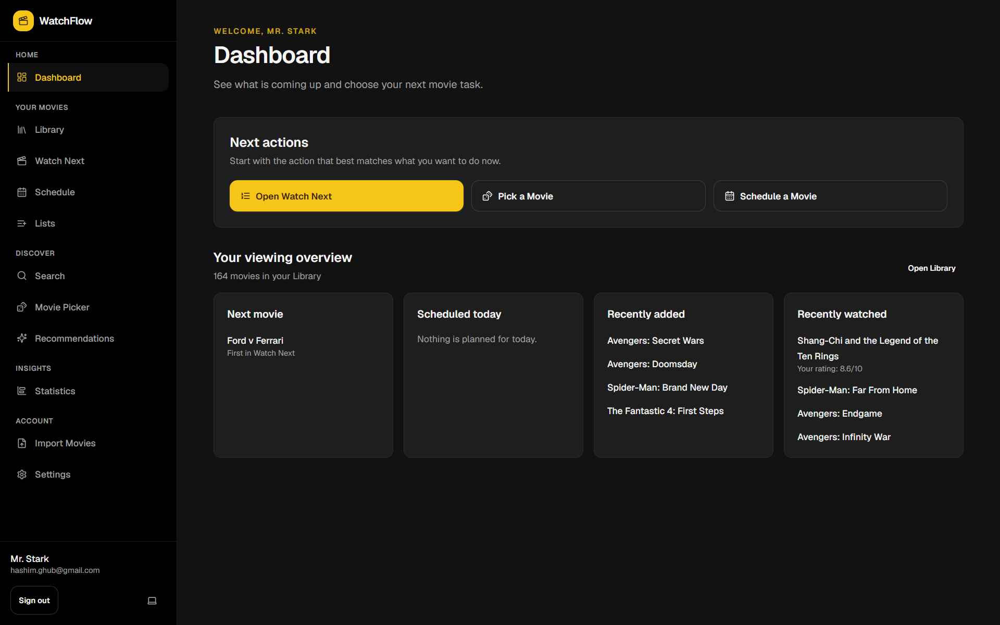

# WatchFlow

**WatchFlow is a private, multi-user movie-management application built with Next.js App Router, TypeScript, Supabase PostgreSQL + RLS, Tailwind CSS, and TMDB.**

Live app: https://watchflow-movies.vercel.app



## At a glance

**Stack:** Next.js · TypeScript · React · Tailwind CSS · Supabase · PostgreSQL · Row Level Security · TMDB · QStash · Web Push · Google Calendar · Vitest · Playwright · Vercel

### Key engineering decisions

- **Per-user isolation with PostgreSQL RLS** — libraries, lists, schedules, preferences, notifications, and private artwork are scoped to the authenticated user.
- **Flat user-movie state model** — Library, Watch Next, Scheduled, Watching, and Watched behavior centers around the user's movie record rather than duplicating movie data across separate systems.
- **Timezone-aware scheduling** — scheduled moments are handled consistently while preserving the user's timezone for correct display and reminder delivery.

---

## What WatchFlow does

WatchFlow gives each user a private workspace for discovering, organizing, scheduling, and tracking movies.

The movies-only v1 includes:

- Authentication and account management
- User profiles and preferences
- TMDB-powered movie search
- Private movie library
- Ratings, reviews, favourites, and watched dates
- Watch Next queue with priority and manual ordering
- Timezone-aware movie scheduling
- Scheduled browser push reminders
- Private custom lists
- Custom list cover artwork
- Private profile artwork
- Movie Picker
- Rule-based recommendations
- Personal statistics
- Notification center
- CSV import
- CSV and JSON exports
- Google Calendar integration
- Password changes
- Account and movie-data deletion
- Privacy, Terms, Support, About, and data-deletion pages
- Responsive PWA support

WatchFlow v1 currently focuses on **movies only**. Series and TV support are intentionally deferred to a later release.

---

## Tech stack

### Frontend

- Next.js App Router
- React
- TypeScript
- Tailwind CSS
- Self-hosted Geist fonts

### Backend and data

- Supabase
- PostgreSQL
- Supabase Auth
- PostgreSQL Row Level Security
- Supabase Storage
- Server Actions
- Server-side TMDB integration

### Background processing

- QStash
- Authenticated internal executor routes
- Web Push / VAPID
- Google Calendar API

### Testing and deployment

- Vitest
- Playwright
- ESLint
- TypeScript
- Vercel
- Supabase migrations and verification scripts

---

## Architecture

WatchFlow uses Supabase as the primary backend platform.

PostgreSQL stores application data, Supabase Auth manages user identity, Row Level Security protects user-owned records, and Supabase Storage handles private profile and list artwork.

Movie metadata is shared where appropriate, while personal data stays scoped to the authenticated user.

Examples of private user-owned data include:

- library state
- ratings and reviews
- favourites
- watched dates
- Watch Next ordering
- schedules
- custom lists
- preferences
- notifications
- push subscriptions
- profile artwork
- list artwork
- Google Calendar connection state

Sensitive service operations stay server-side.

---

## Movie state model

WatchFlow does not create completely separate copies of a movie for every application feature.

A user's movie relationship is centered around their user-movie record, with state and supporting fields determining how that movie appears throughout the application.

This allows the application to support states and workflows such as:

- Saved
- Watch Next
- Scheduled
- Watching
- Watched

Additional fields support things such as:

- priority
- manual ordering
- scheduled time
- timezone
- rating
- review
- favourite state
- watched date

Custom-list membership and background jobs use their own related tables where separate relationships are appropriate.

---

## Authentication and authorization

Authentication is handled by Supabase Auth.

WatchFlow supports:

- sign up
- login
- email verification
- password reset
- password change
- session persistence
- protected application routes
- authenticated account deletion

User-owned database operations rely on PostgreSQL Row Level Security rather than trusting browser-supplied user identifiers.

Administrative/server credentials are restricted to server-side use.

---

## Scheduling and reminders

Movies can be scheduled for a specific time while preserving the user's timezone.

Scheduled reminders use background execution rather than depending on an open browser session.

The reminder system includes:

- configurable reminder lead times
- timezone-aware scheduling
- in-app notifications
- browser push notifications
- authenticated scheduler endpoints
- reminder jobs and delivery records
- duplicate-delivery protection
- retry-safe execution

QStash is the intended scheduler for automatic background execution in v1.

---

## Google Calendar integration

WatchFlow can synchronize scheduled movies with a user's Google Calendar.

The integration includes:

- Google OAuth
- encrypted token storage
- credential rotation support
- calendar connection management
- event creation and reconciliation
- duplicate-event protection
- disconnect handling
- scheduled synchronization

Calendar synchronization is outbound and operates against the user's primary calendar.

---

## Notifications and Web Push

WatchFlow supports private in-app notifications and browser push delivery.

Notification features include:

- notification categories
- unread state
- notification center
- browser push subscriptions
- scheduled reminder notifications
- status-related notifications
- delivery tracking

Web Push uses VAPID credentials stored only in server-side environment configuration.

---

## CSV import and exports

Users can import movie data from CSV.

The import flow supports:

- column mapping
- validation
- row-level decisions
- matching existing movies
- updating existing library records
- import summaries
- invalid/skipped row handling
- failure reporting

Current import safety limits include:

- 2 MB maximum file size
- 500 rows
- 100 columns
- 10,000 characters per field

WatchFlow also supports private CSV and JSON exports.

---

## Private artwork

Users can upload:

- profile artwork
- custom-list cover artwork

Uploads are validated and re-encoded before private storage.

Supported image formats include:

- JPEG
- PNG
- WebP

Artwork validation includes file-size and image-dimension limits.

Private artwork is owner-scoped and is not exposed as a public profile or shared-list feature.

---

## Repository orientation

Important project references include:

- `AGENTS.md`
- `docs/PROJECT_CONTEXT.md`
- `docs/ARCHITECTURE.md`
- `docs/DATABASE.md`
- `docs/SECURITY.md`
- `docs/TESTING.md`
- `docs/WATCHFLOW_V1_RELEASE_CHECKLIST.md`
- `docs/V1_REMINDER_RELEASE_ACCEPTANCE.md`
- `docs/BACKGROUND_EXECUTORS.md`

The `supabase/migrations` directory contains the database migration history.

The `supabase/verification` directory contains database verification scripts used during development and release checks.

---

## Requirements

- Node.js version supported by the current Next.js release
- npm
- Supabase project
- TMDB API read-access token
- PostgreSQL/Supabase database
- Browser with Web Push support for push testing
- Google OAuth credentials for Calendar integration

Install dependencies:

```bash
npm ci
```

---

## Environment variables

Create an ignored local environment file such as `.env.local`.

Never commit real secret values.

Core environment variable names include:

```text
NEXT_PUBLIC_SUPABASE_URL
NEXT_PUBLIC_SUPABASE_PUBLISHABLE_KEY
SUPABASE_SECRET_KEY

TMDB_READ_ACCESS_TOKEN

NEXT_PUBLIC_APP_URL

WATCHFLOW_SCHEDULER_SECRET
WATCHFLOW_EXPECTED_SUPABASE_PROJECT_REF

NEXT_PUBLIC_VAPID_PUBLIC_KEY
VAPID_PRIVATE_KEY
VAPID_SUBJECT

GOOGLE_CALENDAR_CLIENT_ID
GOOGLE_CALENDAR_CLIENT_SECRET
GOOGLE_CALENDAR_REDIRECT_URI

CALENDAR_TOKEN_ENCRYPTION_KEY
CALENDAR_TOKEN_ENCRYPTION_KEY_VERSION
```

Testing environments use additional guarded variables documented in `.env.example` and the testing documentation.

Real passwords, tokens, cookies, Auth state, database credentials, private exports, and service secrets must never be committed.

---

## Database setup

Database changes are managed through the migrations under:

```text
supabase/migrations
```

Before applying migrations to an existing environment:

1. Confirm the target Supabase project.
2. Read the existing migration ledger.
3. Compare it with the repository migration sequence.
4. Apply only confirmed pending migrations in order.
5. Run the repository's verification scripts.
6. Verify RLS and private-data behavior.

Never blindly apply migrations to an unknown or Production database.

---

## Local development

Start the development server:

```bash
npm run dev
```

The default local address is:

```text
http://localhost:3000
```

Supabase Auth redirect URLs must include the appropriate local authentication and recovery routes.

---

## Testing

WatchFlow has automated coverage across application logic, security-sensitive workflows, forms, background execution, and UI behavior.

The current v1 release validation passed:

- **150 test files**
- **1,260 automated tests**
- TypeScript validation
- ESLint
- live development deployment verification
- responsive UI checks
- scheduled reminder end-to-end acceptance
- production-build verification through Vercel

Common quality commands include:

```bash
npm run lint
npm run typecheck
npm test
npm run test:integration
npm run test:e2e
npm run build
npm run scan:client-secrets
```

Some integration and E2E suites intentionally require disposable test users and explicitly configured development environments.

---

## Security

Important security boundaries include:

- PostgreSQL Row Level Security for user-owned records
- server-only Supabase secret credentials
- server-only TMDB credentials
- owner-scoped private Storage
- authenticated background executor routes
- expected-project guards for scheduler execution
- protected OAuth token storage
- bounded CSV processing
- private/no-store exports
- server-side validation for sensitive mutations

The application never relies solely on client-side checks for user-data isolation.

See:

- `docs/SECURITY.md`
- `docs/DATABASE.md`
- `docs/ARCHITECTURE.md`

for more detail.

---

## Deployment

WatchFlow is deployed through Vercel with Supabase providing the backend infrastructure.

Production deployment requires:

- correct Production-only environment variables
- confirmed Supabase migration state
- correct authentication redirect configuration
- Google Calendar OAuth configuration
- VAPID configuration
- scheduler credentials
- isolated Production and Preview environments

QStash is the intended v1 scheduler for reminders and calendar execution.

Production migrations and scheduler activation should be handled as explicit release steps rather than automatically during application startup.

---

## Current project status

The **movies-only WatchFlow v1 application is feature complete**.

The application has completed:

- feature implementation
- final application audit
- UI/UX release sweep
- reminder end-to-end acceptance
- responsive verification
- automated test validation
- public/legal page preparation
- private artwork implementation
- final README/documentation updates

No P0, P1, or P2 application blockers remain from the final v1 audit.

A small set of non-blocking polish items remains deferred to post-v1.

Production infrastructure and release operations are handled separately from application feature completion.

---

## Post-v1 roadmap

Potential follow-up work includes:

- Series / TV support
- improved import UX
- standardized date formatting
- deeper accessibility labeling
- Movie Picker empty-state polish
- additional notification workflows
- further UI consistency improvements
- expanded recommendation systems

---

## Author

**Hashim Javed**

Full-stack developer focused on web applications, automation, and AI-powered systems.
